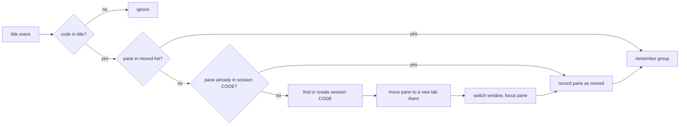

# omp chat groups in Tern — design

## Summary

omp chats in Tern are hard to find and hard to group. This project adds two parts:

1. **A title rule for omp.** Every chat title starts with a stable group code: the issue key without the hyphen, else one of eight work types.
2. **A Tern plugin, `omp-groups`.** It moves each new omp chat into the Tern session named by its code. It adds a picker that lists every saved chat by group and reopens the chosen chat in its group.

## Problem

| Observed | Cause |
|---|---|
| All chats share one tab of one session | Tern does not group agent panes |
| Codes are random per chat (`AUTH` in one chat, `LOGIN` in the next, same topic) | omp makes a new code for each title and does not know the codes of earlier chats |
| A closed chat is hard to get back | Recovery needs `omp --resume <id>` with a known id |

## Goals

- The same issue or work type always gets the same code.
- A new omp chat moves to the Tern session of its code, and the window follows it.
- One picker lists every saved chat by group and reopens the chosen chat in its group.
- The picker and Tern's own session list show the same groups.

## Non-goals

- Regrouping chats that are already open when the plugin loads.
- Changes to omp's own `/resume` picker.

## Group codes

| Code | Use when the chat |
|---|---|
| `<KEY><NUMBER>` (for example `ABC123`) | names an issue key such as `ABC-123` |
| `PR` | reviews a pull request or addresses PR comments |
| `EXPLAIN` | explains a plan, PR, ticket, code path or design |
| `TRIAGE` | investigates a bug, a failed build or a failed test |
| `PLAN` | writes a plan, a spec or a design |
| `BUILD` | implements a change that has no issue key |
| `OMP` | works on omp, Tern or other local tooling |
| `OPS` | works on deploys, infrastructure or environments |
| `MISC` | does anything else |

An issue key wins over a work type. The plugin accepts a code when it is in this list or matches `^[A-Z]{2,10}[0-9]{1,6}$`. Any other code maps to `MISC`, which keeps the number of sessions small when the title model does not obey the rule.

## Part 1 — omp title rule

File: `~/.omp/agent/TITLE_SYSTEM.md` (source: `omp/TITLE_SYSTEM.md`). It applies to every project, unless a project has its own `TITLE_SYSTEM.md` in `<project>/.omp/`, `.claude/`, `.codex/` or `.gemini/`.

Effects, from the omp configuration docs ("Session title prompt override"):

- omp writes the first title with its tiny title model, not with a fork of the main model.
- omp also uses the file when it refreshes a title after a re-plan.
- Titles have no icon. (Tested with omp 18.11.1.)

## Part 2 — Tern plugin `omp-groups`

Files: `plugin.toml` (manifest), `window.luau` (window half), `codes.luau` (pure logic, tested with plain `luau`). The plugin has no host half.

### Title parsing

The plugin reads a code from a pane title with the pattern `^(?:<glyphs> )?([A-Z][A-Z0-9]{1,15}): `. The optional prefix holds icons or spinners and has no ASCII letters or digits. A title without this pattern is not an omp chat title, and the plugin ignores the pane.

### Auto-move

1. **Trigger.** The window event `title`. On `window_start`, every pane that already shows a code goes into the moved list without a move, so starting a window moves nothing. A plugin reload keeps the stored list.
2. **One move per chat.** The moved list (pane id → code) is in `tern.kv`. A later title change does not move the chat again. Each write drops panes that no longer exist. (Tern sends no `pane_closed` event for panes closed through the CLI.)
3. **Create the session.** `cx.sessions:create`. The new session starts with a shell tab. The plugin moves the chat in and closes that shell.
4. **Move.** `cx.layout:move_to_new_tab(pane, session)`. The old tab closes when it becomes empty. No program stops.
5. **Follow.** `cx.sessions:switch`, then `cx.layout:focus`.

### One source of truth for groups

A chat's group is the Tern session that holds it.

| Chat state | Group in the picker |
|---|---|
| Open | The session that holds its pane now (manual moves included) |
| Closed, seen since install | The last session stored for its omp chat id (kv `groups`) |
| Closed, never seen | Its title code, normalized |

The plugin stores the session on every `title` event of a coded pane and on every `focus` event. It finds the omp chat id with an exact title match in the `session_titles` table of `~/.omp/agent/history.db`. When omp has not indexed a new title yet, it tries once more after 3 seconds.

### "Reopen omp chat" picker

- Palette command `plugin.omp-groups.reopen`, bound to `⌘⌥O` (`⌘⇧O` belongs to Tern's key preset), and an **omp chats** status-line button.
- **Chat list.** Rows of `session_titles`, newest first, read with `cx.db`. Rows without a session file under `~/.omp/agent/sessions/*/` are deleted chats and do not show.
- **Picker.** `cx:pick`, one item per chat, under its group heading. Open chats show a check mark.
- **Open chat picked.** Tern focuses it and starts nothing.
- **Closed chat picked.** The plugin switches to (or creates) the group session and opens a new tab with `omp --resume <id>`.

### Time budgets

Tern gives a status formatter 4 ms and other hooks 50 ms. A hook that runs longer is turned off until the next reload. The status formatter therefore returns one prebuilt table and allocates nothing.

### Errors

Every failed step shows an error toast with the reason and leaves the pane where it is.

## Testing

| Test | Expected |
|---|---|
| Title rule | A PR prompt gives `PR: …`. A prompt that names `ABC-123` gives `ABC123: …`. |
| Auto-move | Each new chat moves to the session of its code, and the window follows it |
| No second move | `/rename` does not move a moved chat |
| Group memory | A renamed, closed chat shows under the session it was in |
| Reopen | A closed chat opens in its group with its history. An open chat gets focus, and no new process starts. |
| Load safety | `tern plugin reload` moves no pane |
| Budgets | 80 focus changes and 6 picker opens log no budget warning |
