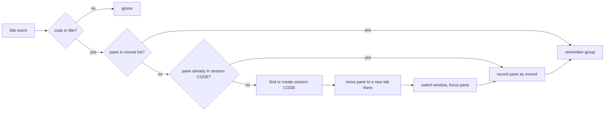

# omp chat groups in Tern — design

## Summary

omp chats in Tern are hard to find and hard to group. This project adds three parts:

1. **A title rule for omp.** Every chat title starts with a stable group code: the issue key without the hyphen, else one of eight work types.
2. **A Tern plugin, `omp-groups`.** It moves each new omp chat into the Tern session named by its code. It adds a picker that lists every saved chat by group, with its subagents, and reopens the chosen chat in its group. It shows the history of any chat or subagent as a scrollable note.
3. **A setup script, `install.sh`.** It installs, updates, links and removes all of the above in one command.

## Problem

| Observed | Cause |
|---|---|
| All chats share one tab of one session | Tern does not group agent panes |
| Codes are random per chat (`AUTH` in one chat, `LOGIN` in the next, same topic) | omp makes a new code for each title and does not know the codes of earlier chats |
| A closed chat is hard to get back | Recovery needs `omp --resume <id>` with a known id |
| Subagents are hard to reach | A subagent has no Tern pane, and its transcript is a file under the chat's folder |
| History is hard to read | A closed chat must be resumed to read it. A subagent's history has no viewer in Tern. |

## Goals

- The same issue or work type always gets the same code.
- A new omp chat moves to the Tern session of its code, and the window follows it.
- One picker lists every saved chat by group, with its subagents, and reopens the chosen chat in its group.
- The history of any chat or subagent opens as a scrollable note, without starting omp.
- The picker and Tern's own session list show the same groups.
- One command sets everything up.

## Non-goals

- Regrouping chats that are already open when the plugin loads.
- Changes to omp's own `/resume` picker.

## Group codes

| Code | Use when the chat |
|---|---|
| `<KEY><NUMBER>` (for example `ABC123`) | names an issue key such as `ABC-123` |
| `PR` | reviews a pull request or addresses PR comments |
| `EXPLAIN` | explains a plan, PR, ticket, code path or design |
| `TRIAGE` | investigates a bug, a failed build or a failed test |
| `PLAN` | writes a plan, a spec or a design |
| `BUILD` | implements a change that has no issue key |
| `OMP` | works on omp, Tern or other local tooling |
| `OPS` | works on deploys, infrastructure or environments |
| `MISC` | does anything else |

An issue key wins over a work type. The plugin accepts a code when it is in this list or matches `^[A-Z]{2,10}[0-9]{1,6}$`. Any other code maps to `MISC`, which keeps the number of sessions small when the title model does not obey the rule.

## Part 1 — omp title rule

File: `~/.omp/agent/TITLE_SYSTEM.md` (source: `omp/TITLE_SYSTEM.md`). It applies to every project, unless a project has its own `TITLE_SYSTEM.md` in `<project>/.omp/`, `.claude/`, `.codex/` or `.gemini/`.

Effects, from the omp configuration docs ("Session title prompt override"):

- omp writes the first title with its tiny title model, not with a fork of the main model.
- omp also uses the file when it refreshes a title after a re-plan.
- Titles have no icon. (Tested with omp 18.11.1.)

## Part 2 — Tern plugin `omp-groups`

Files: `plugin.toml` (manifest), `window.luau` (window half), `codes.luau` and `transcript.luau` (pure logic, tested with plain `luau`). The plugin has no host half.

### Title parsing

The plugin reads a code from a pane title with the pattern `^(?:<glyphs> )?([A-Z][A-Z0-9]{1,15}): `. The optional prefix holds icons or spinners and has no ASCII letters or digits. A title without this pattern is not an omp chat title, and the plugin ignores the pane.

### Auto-move

1. **Trigger.** The window event `title`. On `window_start`, every pane that already shows a code goes into the moved list without a move, so starting a window moves nothing. A plugin reload keeps the stored list.
2. **One move per chat.** The moved list (pane id → code) is in `tern.kv`. A later title change does not move the chat again. Each write drops panes that no longer exist. (Tern sends no `pane_closed` event for panes closed through the CLI.)
3. **Create the session.** `cx.sessions:create`. The new session starts with a shell tab. The plugin moves the chat in and closes that shell.
4. **Move.** `cx.layout:move_to_new_tab(pane, session)`. The old tab closes when it becomes empty. No program stops.
5. **Follow.** `cx.sessions:switch`, then `cx.layout:focus`.

### One source of truth for groups

A chat's group is the Tern session that holds it.

| Chat state | Group in the picker |
|---|---|
| Open | The session that holds its pane now (manual moves included) |
| Closed, seen since install | The last session stored for its omp chat id (kv `groups`) |
| Closed, never seen | Its title code, normalized |

The plugin stores the session on every `title` event of a coded pane and on every `focus` event. It finds the omp chat id with an exact title match in the `session_titles` table of `~/.omp/agent/history.db`. When omp has not indexed a new title yet, it tries once more after 3 seconds.

### "Reopen omp chat" picker

- Palette command `plugin.omp-groups.reopen`, bound to `⌘⌥O` (`⌘⇧O` belongs to Tern's key preset), and a status-line button that shows Tern's built-in `history` icon and no text.
- **Chat list.** Rows of `session_titles`, newest first, read with `cx.db`. Rows without a session file under `~/.omp/agent/sessions/*/` are deleted chats and do not show.
- **Subagent list.** omp saves subagent `X` of a chat as `<chat folder>/X.jsonl`, and the agents that `X` started under `<chat folder>/X/`. The picker shows them below their chat as `↳ X` rows, each parent before its children, indented by depth. omp saves no title for a subagent, so it has no `session_titles` row.
- **Picker.** `cx:pick`, one item per chat or subagent, under its group heading. Open chats show a check mark.
- **Open chat picked.** Tern focuses it and starts nothing.
- **Closed chat picked.** The plugin switches to (or creates) the group session and opens a new tab with `omp --resume <id>`.
- **Subagent picked.** The plugin opens its history note. A subagent has no pane to switch to.

### "Read omp chat history"

- Palette command `plugin.omp-groups.history`. The same picker, but every row opens its history note.
- **Note.** `cx.docs:new_note` with the agent name or chat title as its heading. One section per user or assistant message, oldest first, with the UTC time. An assistant message with only tool calls joins the section before it as `- \`tool\` intent` lines. Thinking, tool results and `developer` messages do not show.
- **Reading.** `tern.fs.read` of the session file. The plugin decodes only lines whose first 400 bytes name a user or assistant message, so it never decodes tool results, the longest lines.
- **Size.** When the note is longer than 512 KiB, the oldest sections are left out, and the note says how many.
- The pure parts (`transcript.agents`, `transcript.wanted`, `transcript.markdown`) are in `transcript.luau` and have tests.

### Time budgets

Tern gives a status formatter 4 ms and other hooks 50 ms. A hook that runs longer is turned off until the next reload. The status formatter therefore returns one prebuilt table and allocates nothing.

This does not stop every overrun. The prebuilt formatter still went over 4 ms once. The likely cause is work that Tern does in the plugin VM around each call, which the plugin cannot control. Tern reports the overrun only in `~/Library/Logs/Tern/tern.log`. `tern plugin list` still shows `ready`.

So an omp hook, `omp/reload-hook.ts`, restores the plugin. On omp `session_start` inside Tern (`TERN_PANE` is set), it reads the last 1 MiB of `tern.log`. It runs `tern plugin reload` when the latest `disabled until reload plugin="omp-groups"` line comes from the current Tern process. It skips a line that it already handled, which it records in `~/.local/state/tern-omp-groups/handled-disable`. It records the line before it reloads, so chats that start together reload once. `TERN_WINDOW_KEY` can be present but empty inside omp, so the hook does not use it. omp skips symlinked hook files, so the installed hook is a one-line file that re-exports `omp/reload-hook.ts`.

### Errors

Every failed step shows an error toast with the reason and leaves the pane where it is.

## Setup script

`install.sh` does the five setup steps that the README used to list:

1. Install the plugin from GitHub (`--force` updates it), or link the checkout with `--dev`. It removes the other kind first, because Tern refuses a link while an installed copy exists.
2. Install `omp/TITLE_SYSTEM.md` to `~/.omp/agent/` (a symlink with `--dev`). A rule that is not ours (its first line differs) is kept once as `TITLE_SYSTEM.md.bak`.
3. Set `"status_bar": true` in Tern's `settings.json` with `osascript -l JavaScript`, which every Mac has. It keeps the other keys and their order. Tern reads the file again when it changes.
4. Write the one-line reload hook that re-exports `omp/reload-hook.ts`.
5. Check that `tern plugin list` shows the plugin as `ready`.

`--uninstall` reverses steps 1, 2 and 4, restores the backup rule, and deletes the hook state. It leaves the status line on.

## Testing

| Test | Expected |
|---|---|
| Title rule | A PR prompt gives `PR: …`. A prompt that names `ABC-123` gives `ABC123: …`. |
| Auto-move | Each new chat moves to the session of its code, and the window follows it |
| No second move | `/rename` does not move a moved chat |
| Group memory | A renamed, closed chat shows under the session it was in |
| Reopen | A closed chat opens in its group with its history. An open chat gets focus, and no new process starts. |
| Load safety | `tern plugin reload` moves no pane |
| Subagents | A chat that started subagents shows them below it, children below their lead |
| History note | Picking a subagent (or any row in **Read omp chat history**) opens a note with its messages and tool lines, without thinking or tool output |
| Setup | `install.sh`, `install.sh --dev` and `install.sh --uninstall` in a sandbox `HOME` and `TERN_CONFIG_DIR` keep a foreign rule, set the status line, and restore the rule |
| Budgets | 80 focus changes and 6 picker opens log no budget warning |
